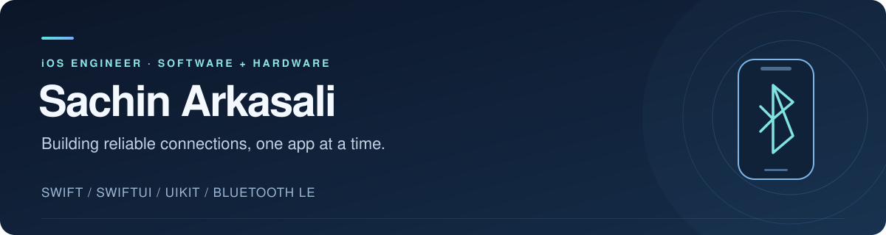

  

  <a href="https://www.linkedin.com/in/sachinarkasali/">LinkedIn</a> &nbsp;·&nbsp;
  <a href="mailto:sachinarkasali5@gmail.com">Email</a> &nbsp;·&nbsp;
  <a href="https://leetcode.com/u/Sachin_arkasali/">LeetCode</a>

## Hello, I'm Sachin

I'm a **Senior Software Engineer focused on iOS** at **Bosch Global Software Technologies**, based in Bengaluru, India. I've been building iOS apps since 2022, with a focus on **Bluetooth Low Energy, hardware integration, and dependable device communication**.

I work across the app lifecycle: designing reusable components, building SwiftUI and UIKit interfaces, integrating hardware, and shipping through TestFlight and the App Store.

## Professional experience

**Bosch Global Software Technologies**  
Senior Software Engineer · July 2022–present  
iOS Developer Intern · April–June 2022

My work on **Levelling Remote**, a production app for Bosch construction levelling tools, includes:

- Owning BLE integration and bidirectional communication with measuring devices, including reconnection flows for challenging field conditions.
- Using CoreBluetooth and Swift Concurrency to manage device communication.
- Building modular networking with URLSession and async/await.
- Integrating Tealium analytics and supporting hardware onboarding, localisation, and App Store releases.

## Tools I work with

| Area | Technologies & practices |
| :--- | :--- |
| Languages & UI | Swift, SwiftUI, UIKit |
| Hardware & concurrency | CoreBluetooth, BLE, Swift Concurrency, async/await |
| Architecture | MVVM, modularisation, protocol-oriented programming, SOLID |
| Networking & storage | URLSession, REST APIs, JSON, Core Data |
| Quality & delivery | XCTest, Swift Package Manager, Git, code review, Azure DevOps, TestFlight, App Store Connect |

## Explore my public projects

Independent projects exploring the engineering patterns I use in iOS development.

| Project | Focus |
| :--- | :--- |
| [**BluetoothScanner**](https://github.com/sachinarkasali944/BluetoothScanner) | CoreBluetooth discovery, signal history, and service and characteristic inspection in SwiftUI. |
| [**MovieDBExplorer**](https://github.com/sachinarkasali944/MovieDBExplorer) | TMDB integration, paginated browsing, debounced search, and SwiftData favourites. |
| [**GitHubUserFinder**](https://github.com/sachinarkasali944/GitHubUserFinder) | Actor-based networking, parallel async requests, and clear loading and error states. |

## Recognition

- **Bosch Global Best Software Quality Project Award · 2025** — recognised for work on a hardware-integrated iOS solution used across global markets.
- **Gem – Extra Miler Award · June 2025** — recognised for contributions beyond my role.

## Beyond the app

I practise data structures and algorithms on [LeetCode](https://leetcode.com/u/Sachin_arkasali/) and explore reusable Swift components and mobile architecture.

**Education:** B.E. in Electronics and Communication Engineering, KLE Institute of Technology, 2018–2022.

---

Interested in iOS, BLE, or mobile architecture? [Let's connect](https://www.linkedin.com/in/sachinarkasali/).
